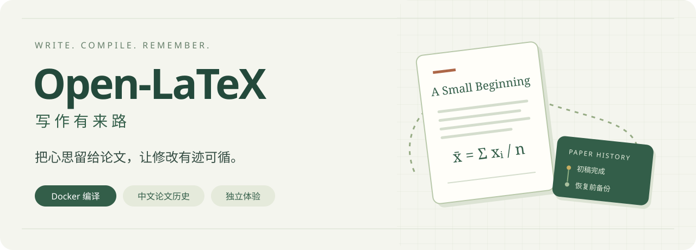
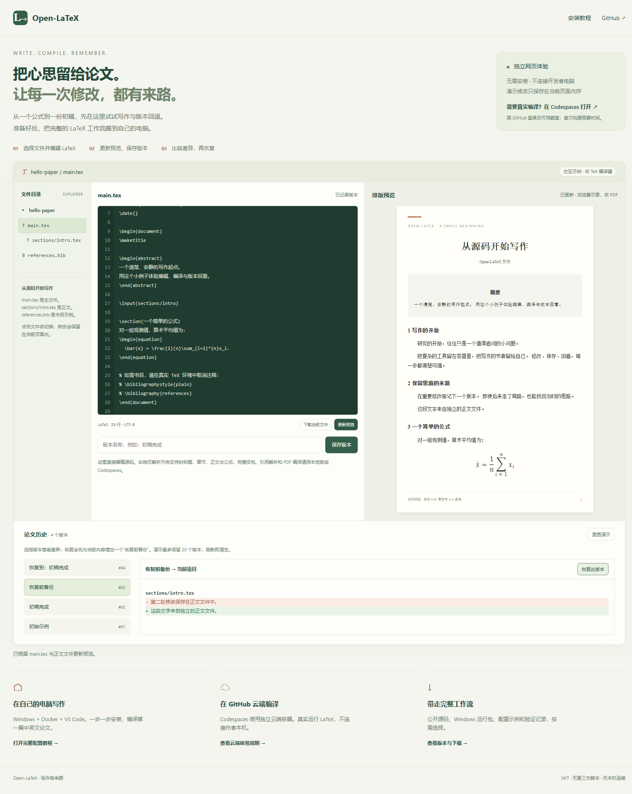

<p align="center">
  
</p>

<h1 align="center">Open-LaTeX · 写作有来路</h1>

<p align="center">
  写下一行，编译一页，记住每一次重要修改。<br>
  Docker 编译 · VS Code 预览 · 中文论文历史 · Windows 启动入口
</p>

<p align="center">
  <a href="https://Maverickquliushang.github.io/Open-LaTeX/"><strong>打开交互演示 ↗</strong></a> &nbsp; · &nbsp;
  <a href="docs/GETTING_STARTED.md"><strong>一步一步安装</strong></a> &nbsp; · &nbsp;
  <a href="https://github.com/Maverickquliushang/Open-LaTeX/releases">下载运行包</a> &nbsp; · &nbsp;
  <a href="docs/ONLINE.md">GitHub 云端编译</a>
</p>

<p align="center">
  <a href="#你可以用它做什么">功能一览</a> ·
  <a href="#先看效果再开始">效果展示</a> ·
  <a href="#三条开始路线">开始使用</a> ·
  <a href="#文件在哪里历史在哪里">数据边界</a> ·
  <a href="CHANGELOG.md">变更记录</a>
</p>

---

## 把写作、编译和回看连起来

Open-LaTeX 把 LaTeX 工具链放进 Docker Linux 容器，在 VS Code 中编辑和预览，把每篇论文的修改记录留在自己的写作目录。写作前打开启动器，重要修改前保存一个命名版本，出问题时先看日志，再找回上一个节点。

**完整写作在本地，初次体验在网页。** 在线演示不连接开发者电脑；需要真实云端编译，可以使用你自己的 GitHub Codespaces。

<table>
<tr>
<td width="50%" valign="top">

### ⌂ 本地工作流 · 自己掌握

Windows + Docker Desktop + VS Code。真实 TeX 编译、PDF 预览、独立论文历史和按需启动器。

**文件在本机 · 多引擎编译 · 历史可比较与恢复**

[从零开始配置 →](docs/GETTING_STARTED.md)

</td>
<td width="50%" valign="top">

### ☁ 在线体验 · 打开就试

GitHub Pages 展示文字编辑、版本命名、差异与恢复前备份。另附 Codespaces 云端编译配置。

**无本机连接 · Pages 无需登录 · 云端编译可选**

[打开交互演示 →](https://Maverickquliushang.github.io/Open-LaTeX/)

</td>
</tr>
</table>

## 先看效果，再开始

<p align="center">
  
</p>

上图是随仓库发布的**浏览器演示页面**，不是 VS Code 截图。左侧选择 `main.tex`、`sections/intro.tex` 或 `references.bib`，中间直接修改 LaTeX 源码，右侧点击“更新预览”。可以保存“初稿完成”、继续修改，再按文件比较差异并恢复整个示例项目；恢复前会增加备份版本。页面排版由 HTML / MathML 完成，**不是在线 TeX 编译器**。真实 PDF 编译请使用本地版或 Codespaces。

本地完成配置后，工作路径是：

```text
Start-LaTeX.exe
  → 检查 Docker、启动写作容器
  → 请求 VS Code 打开 /work
  → 编辑 .tex，选择编译引擎
  → 预览 PDF，并同步到论文的 output/
  → 在“论文历史”面板比较、命名或恢复版本
```

## 你可以用它做什么

| 环节 | Open-LaTeX 提供的能力 |
| :--- | :--- |
| **01 / 先写起来** | 提供独立中英文入门样例、Windows 启动器和 VS Code 配置示例。 |
| **02 / 交给容器编译** | 通过 latexmk 调用 pdfLaTeX、XeLaTeX 或 LuaLaTeX；隔离工具链与内部构建缓存。 |
| **03 / 及时看结果** | 成功 PDF 发布到容器预览目录，并回传到主文件同级 `output/`。 |
| **04 / 看懂问题** | 分开报告编译返回码、引用/书目、字体、版面；日志缺失或过期明确为未知。 |
| **05 / 留住重要版本** | 每篇论文单独保留本地 Git 历史，中文面板支持比较、命名和恢复前备份。 |
| **06 / 更新有据可查** | 按部署清单记录哈希、备份和回滚，不把私人论文当作公开源码。 |

> **成功生成 PDF 不等于没有问题。** 缺引用、字体替代、溢出版面需要分别检查。编译失败会保留上次成功的 PDF，不能因为预览仍在就认为这次编译成功。

## 三条开始路线

| 你现在想做什么 | 从这里开始 | 需要准备什么 |
|---|---|---|
| **先试操作** | [GitHub Pages 演示](https://Maverickquliushang.github.io/Open-LaTeX/) | 浏览器；修改仅在本页内存，刷新清空 |
| **正式写论文** | [Windows 手把手教程](docs/GETTING_STARTED.md) | Docker Desktop Linux 引擎、VS Code、Dev Containers、运行包 |
| **只在 GitHub 上编译** | [Codespaces 逐步教程](docs/ONLINE.md) | GitHub 账号与可用额度；等待首次云端环境构建 |

**只有 Docker 还不能双击即用。** 首次还需构建 TeX 镜像、创建 `/work` 挂载、安装容器扩展、填写配置和注册按需历史任务。教程把每一步的操作位置、命令、成功标志与常见错误都列出来了。

下载源码不需要 Git：点击 **Code → Download ZIP**。Windows EXE / VSIX 随 [Release 运行包](https://github.com/Maverickquliushang/Open-LaTeX/releases)提供；也可用 Python 和 Windows 自带的 .NET Framework 编译器运行 `code/scripts/build.ps1` 自行构建。

### 三种体验的边界

| | 本地 Windows | Pages 演示 | Codespaces 配置 |
|---|---|---|---|
| 真实 TeX 编译 | 支持三种引擎 | 不提供，浏览器排版示意 | 提供入门 pdfLaTeX / XeLaTeX 工具链 |
| 论文保存位置 | 你的写作目录 | 当前页内存，可下载示例源码 | 你自己的 GitHub 云端环境 |
| 论文历史 | 本地 Git + 中文扩展 | 内存中的交互示例，最多 20 个版本 | 真实 Git；按需手动记录 |
| Windows 启动器 / 计划任务 | 支持 | 不运行 | 不运行 |
| 访问开发者电脑 | 不需要 | 不需要 | 不需要 |
| 完整期刊模板与字体 | 按模板要求配置 | 不适用 | 入门配方不保证覆盖所有模板 |

## 文件在哪里，历史在哪里

**Docker、Git 和 GitHub 各有用途。** Docker 提供编译环境；Git 在每篇论文目录保存修改；GitHub 托管这份开源工具。使用本地论文历史不会自动上传 GitHub。

公开发行不包含私人论文、论文 Git、密钥、个人路径或运行缓存。写作目录独立于源码目录，实际配置由用户填写。历史仍保存在同一块磁盘，应另外备份完整写作目录；恢复源码后需重新编译 PDF。

Pages 页面没有第三方脚本和后端连接，输入只用于本页演示。Codespaces 是访问者自己的云端环境，额度与费用按 GitHub 账号设置计算；用完请停止环境并下载自己的文件。

## 配置教程索引

1. [安装 Docker 与 VS Code](docs/GETTING_STARTED.md#1-安装-docker-desktop)
2. [下载源码与运行包](docs/GETTING_STARTED.md#3-下载源码和-windows-运行包)
3. [构建镜像、创建容器](docs/GETTING_STARTED.md#5-构建-tex-镜像)
4. [填写运行配置与复制示例](docs/GETTING_STARTED.md#7-写入配置并复制两个入门示例)
5. [编译第一篇英文与中文论文](docs/GETTING_STARTED.md#8-先用命令编译第一篇论文)
6. [连接 VS Code 与安装扩展](docs/GETTING_STARTED.md#9-在-vs-code-中编辑与预览)
7. [设置历史与日常启动](docs/GETTING_STARTED.md#10-设置按需论文历史与日常启动)
8. [常见问题逐步排查](docs/GETTING_STARTED.md#12-常见问题先定位是哪一步)

## 给开发者的地图

```text
code/                       唯一当前源码入口
  src/tools/                编译、审计、论文历史、Windows 启动器
  src/extension/            中文论文历史 VS Code 扩展
  web/                      独立 Pages 交互演示；仅此目录发布为站点
  examples/                 原创中英文入门样例
  config/                   Docker 与运行配置示例
  scripts/、tests/          构建、验证、部署、归档与隔离测试
  .tmp/、.cache/、.local/   本地临时与私人资料，不上传
 docs/                      手把手教程、展示图片、维护与验证说明
 versions/                  交付说明、包含清单与校验摘要
 .github/workflows/         Pages 发布工作流
 .devcontainer/             GitHub Codespaces 入口
```

从项目根运行：

```powershell
. ./project-env.ps1
./code/scripts/build.ps1
./code/scripts/test.ps1 -BuildImage
./code/scripts/test-launchers.ps1 -ContainerName open-latex-dev-validation
```

当前产品版本 **0.1.1**，中文历史扩展 **1.0.1**。验证结论与未覆盖项目见 [VALIDATION](docs/VALIDATION.md)，结构见 [ARCHITECTURE](docs/ARCHITECTURE.md)，更新与回滚见 [MAINTENANCE](docs/MAINTENANCE.md)。完整工具链仍涉及在线软件源安装，不宣称完全离线或逐包可复现。

采用 [MIT License](LICENSE)。Docker、TeX Live、字体、VS Code 和其他第三方组件遵守各自许可；会议与期刊模板由使用者从官方来源获取。详见[来源说明](docs/THIRD_PARTY.md)。
